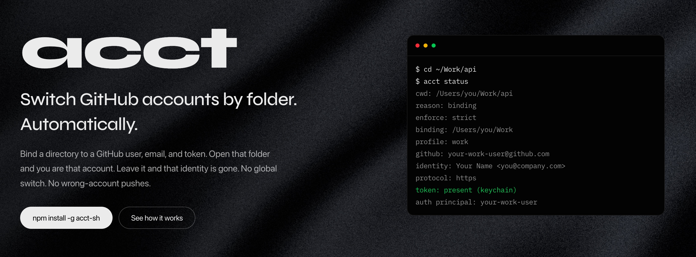

<p align="center">
  
</p>

<h1 align="center">acct</h1>

<p align="center">
  <strong>One folder. One GitHub account. One identity. No leaks.</strong>
</p>

<p align="center">
  Directory-scoped GitHub identity + auth.<br />
  Local always wins. Fail closed when it doesn’t.
</p>

<p align="center">
  <a href="https://www.npmjs.com/package/acct-sh"></a>
  <a href="https://www.npmjs.com/package/acct-sh"></a>
  <a href="LICENSE"></a>
  <a href="https://nodejs.org">= 20" /></a>
  <a href="https://acct-web.vercel.app/"></a>
  <a href="https://acct-web.vercel.app/docs"></a>
</p>

<p align="center">
  <a href="https://acct-web.vercel.app/">
    
  </a>
</p>

<p align="center">
  <a href="https://acct-web.vercel.app/"><strong>acct-web.vercel.app</strong></a>
  ·
  <a href="https://acct-web.vercel.app/docs"><strong>command reference</strong></a>
</p>

---

## The problem

`user.name` / `user.email` are not auth.  
`gh auth switch` is global.  
HTTPS credentials are host-scoped by default.  
SSH agents and host-specific key configuration can authenticate the wrong account.

Cross a directory boundary and you can silently push as the wrong person.

Official `gh` documents that automatic switching by directory is **out of scope**.  
`acct` owns that gap.

## The invariant

> **One GitHub account + one git identity + one directory tree.**  
> Local supersedes global. Outside a bound directory, that account does not exist for `acct`-managed operations. When constraints fail and enforcement is on — **block**.

## Install

```bash
npm install -g acct-sh
```

Install prints next steps when scripts are visible (`--foreground-scripts`). Otherwise run `acct` after install for the same tip sheet. Skip with `ACCT_SKIP_POSTINSTALL=1`.

Also on [GitHub Packages](https://github.com/abdull-ah-med/acct/pkgs/npm/acct-sh) as `@abdull-ah-med/acct-sh` (same bins).

## Quick start

```bash
# In this folder: step-by-step (echoes each field, confirms at the end)
acct
# or: acct init

# Shell hook (zsh)
eval "$(acct hook zsh)"

# Inside the bound tree
cd ~/Work/some-repo
acct status
acct whoami
acct doctor          # conflict scan — run this first when something feels off
```

Walk into `~/Work` → work account.  
Walk out → that identity is gone.

## Trust check: `acct doctor` / `acct status`

When something is off (`token: missing`, `LEAK RISK`, identity mismatch, wrong `gh` active account), `acct status` and `acct doctor` explain:

1. **What's wrong** — the specific cause, not a generic guess
2. **Commands to run** (cause-specific: `cd` into a repo, `git config --local --unset-all user.*`, `acct install`, `gh auth switch --hostname … --user …`, `gh auth refresh --hostname …`, …)
3. **Whether commit / push will go through** — and whether they would use the wrong GitHub account

Standing in a binding directory that is **not a git repo** is not an identity error (`includeIf gitdir` only matches inside repos). `acct` does **not** run `gh auth switch` (that is global). Status prints `gh active` from stored gh config separately from the profile principal; use `acct exec` / the shell hook, or switch only if you want raw `gh` to follow that account everywhere.

In `strict` mode a missing profile token or a mismatched `gh` principal **blocks push**. A commit still uses `includeIf` `user.name` / `user.email` (not `gh`), so it will not pick up the other GitHub login. Raw `gh` without `acct exec` *can* still be the wrong user — that's the leak risk.

```bash
acct status            # cwd dump + diagnosis when unhealthy (exit 1)
acct doctor            # helper/keychain scan + the same cwd diagnosis
acct doctor --online   # also verify ambient GH_TOKEN vs cwd profile via gh api
```

Doctor also reports credential-helper competition, missing install blocks, orphan bindings, sticky `GH_TOKEN`, enforce fallthrough, and whether the native keyring backend loads on this machine. Exit code `1` if any **error** findings.

## What it wires

| Plane | What `acct` does |
|-------|------------------|
| **Identity** | `includeIf` git config — `user.name` / `user.email` per directory |
| **HTTPS** | `git-credential-acct` returns *this* profile’s token; `quit=true` on strict failure |
| **SSH** | `core.sshCommand` with `IdentitiesOnly=yes` |
| **gh** | Injects `GH_TOKEN` from the OS keychain — no `gh auth switch` |
| **Enforce** | pre-commit, pre-merge-commit and pre-push checks; all client hooks chain to existing hooks |

## Resolution order

1. CLI `--profile` (explicit; gh plane / status)
2. Nearest `.acct` from the Git worktree root upward (cwd outside Git); markers below the root are ignored and reported
3. Longest canonical directory binding; worktree/gitdir disagreement without a marker is a strict conflict
4. Unbound

Local always beats global. Ambient `ACCT_PROFILE` does **not** override git credential helper or hooks — directory wins.

## Commands

Full reference (every command, flag, and example): **[acct-web.vercel.app/docs](https://acct-web.vercel.app/docs)**

```bash
acct --help
```

| Command | Purpose |
|---------|---------|
| `acct init` | Profile + binding + install |
| `acct profile add\|list\|show\|remove\|token\|ssh-key` | Profiles |
| `acct bind` / `unbind` / `rebind <old> <new>` | Directory → profile |
| `acct status` / `whoami` | Current resolution; status explains problems + fix + commit/push impact |
| `acct doctor` | Conflict / keychain scan + cwd diagnosis when unhealthy |
| `acct exec -- <cmd>` | Run with correct `GH_TOKEN` |
| `acct clone <url>` | Clone under current profile env |
| `acct enforce strict\|warn\|off` | Enforcement mode |
| `acct hook bash\|zsh\|fish\|powershell` | Shell integration |
| `acct install [--repo]` / `uninstall` | Global hooks by default, optional local override; chain and restore existing hooks |

## Upgrading to 0.2.0

After updating the npm package, run `acct install` once to regenerate the scoped
includes and v3 hook shims. Profiles and bindings retain schema version 1.
Installation is now global by default and chains existing repository hooks. Use
`acct install --repo` where a local hooksPath overrides it. `acct uninstall`
restores recorded hook paths and preserves unrelated Git configuration.

`acct local set <id>` places `.acct` at the repository root and installs the
matching local include. `acct local clear` removes only acct's local include.
When a directory moves, use `acct rebind <old> <new>`; doctor reports missing paths.

Persist the shell hook using [shell/README.md](shell/README.md). Bash runs it at
the next prompt: `cd repo && gh ...` runs before refresh. Use `acct exec -- gh ...`
or the generated gh wrapper for immediate resolution. Run `acct_refresh` after
changing config in an open shell.

`acct whoami` exits 0 for a match, 1 for mismatch, and 2 when unknown. Offline
diagnostics cannot establish remote authentication. Recorded-author checks use
local operation/reflog evidence for cherry-picks and similar operations; imported
history without that evidence can be refused in strict mode.

## Platforms & OS keychain

Tokens are stored via [`@napi-rs/keyring`](https://www.npmjs.com/package/@napi-rs/keyring) (native bindings). Behavior differs by OS:

| OS | Backend | Notes |
|----|---------|--------|
| **macOS** | Keychain | Primary test target. CI: `macos-latest` (unit + e2e). |
| **Linux** | Secret Service via **libsecret** (GNOME Keyring / KWallet) | Unit + e2e in CI (`ubuntu-latest`) use `ACCT_SECRET_BACKEND=file`. Headless/CI hosts often lack a session keyring — prefer the file backend there, or unlock a Secret Service session for keyring mode. |
| **Windows** | Credential Manager | Unit tests in CI (`windows-latest`). Keychain UX differs from macOS; run `acct doctor` after install. |

**CI matrix:** Node 20 + 22 × Ubuntu / macOS / Windows. Security regression and directory e2e run on Ubuntu and macOS. Tests use temporary home/config directories, a fake gh, and `ACCT_SECRET_BACKEND=file`; CI does not establish live keychain or real-account coverage.

Explicit opt-in for plaintext storage (CI / locked-down hosts):

```bash
export ACCT_SECRET_BACKEND=file   # → ~/.config/acct/secrets.json (0600)
```

## Security

- Tokens live in the **OS keychain** by default — never in `config.yaml`. HTTPS and `acct exec` follow `gh auth token --hostname --user` for that profile (no `gh auth switch`), so `gh auth refresh` is enough; you do not need to re-run `acct profile token --import-gh`. A PAT stored with `--stdin` is not overwritten (`followGh: false`). Set `ACCT_FOLLOW_GH=0` to disable.
- Credential helper rejects empty / non-allowlisted hosts
- Helper resets apply only to managed HTTPS hosts, plus gist.github.com for github.com. Other hosts keep their helpers. Strict storage/config errors stop helper fallthrough.
- Shell hooks use the shared Git resolver, ignore sticky `ACCT_PROFILE`, clear tokens on failure/unbound, and export a blocking sentinel when a bound strict profile lacks a token. `acct exec` refuses gh in that case.
- IdentitiesOnly stops agent keys; keys configured for that host in ~/.ssh/config are still offered — acct verifies the authenticated account on push.
- Tokens reject whitespace/NUL. Rotation/deletion leaves no secret backup; automatic keyring migration preserves the primary value and removes migrated file copies.
- Config edits serialize across processes and roll back on failure. Editing after uninstall saves config without reinstalling Git artifacts.
- Client hooks can be bypassed with `--no-verify` or a different hooksPath. Use server-side controls for mandatory policy. `acct exec` does not sandbox arbitrary programs that read their injected environment.

See [threat model](https://github.com/abdull-ah-med/acct/blob/main/docs/threat-model.md) and [invariants](https://github.com/abdull-ah-med/acct/blob/main/docs/invariants.md).

## How it feels

```text
~/Personal/blog     →  personal · commits as you@home
~/Work/api          →  work     · commits as you@company · work token only
~/Downloads         →  unbound  · acct does nothing / strict blocks managed ops
```

No global flip. No “forgot to switch.” No silent wrong-account push.

## Agent / contributors

**For coding agents discovering this package:** start at the website LLM index —

- https://acct-web.vercel.app/llms.txt  
- https://acct-web.vercel.app/llms-full.txt  
- https://acct-web.vercel.app/agents.md  

Read [AGENTS.md](https://github.com/abdull-ah-med/acct/blob/main/AGENTS.md) in the repo.  
Verify primary docs in [SOURCE_OF_TRUTH.md](https://github.com/abdull-ah-med/acct/blob/main/docs/sources/SOURCE_OF_TRUTH.md) before changing auth behavior.  
How we test: [docs/testing.md](https://github.com/abdull-ah-med/acct/blob/main/docs/testing.md).

## License

[MIT](LICENSE)

Pre-commit checks effective author and committer identities, but cannot inspect the final recorded commit. `git commit --author=…` changes invisible to pre-commit are caught at **pre-push**, which re-verifies outgoing commit objects. Post-commit only passes through to existing hooks. Commits in repositories that are never pushed are not re-checked.

Global hook shims bake the previous global `core.hooksPath` at install. `acct install --repo` creates separate shims for the repository’s canonical common Git directory and bakes its previous local hooks path (for example, `.husky`). Re-run install after changing a chain target. Uninstall restores recorded paths and removes per-repository shim directories.
